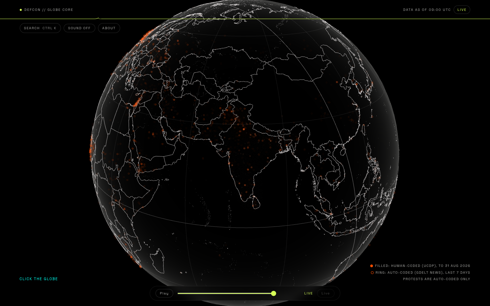
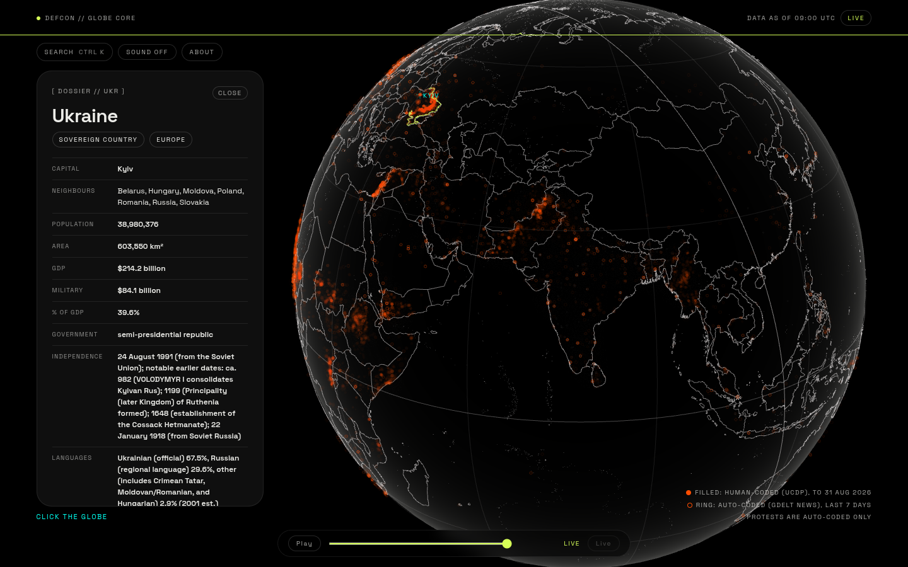

# Defcon

[](https://github.com/Tribal-Chief-001/defcon/actions/workflows/ci.yml)
[](https://github.com/Tribal-Chief-001/defcon/actions/workflows/ingest.yml)
[](LICENSE)


**A real-time 3D world monitor of armed conflict and civil unrest, and a frontend design showcase.** True-black, hairline, sonar-lit globe; every border drawn from **India's official map**; every event labelled human-coded or auto-coded; missing data shown as missing.





## Features

- **Custom Three.js globe** (WebGL2, no map library) with a sonar boot, hairline borders in two detail levels, picking, and sonar ripples at events.
- **Events from public datasets:** UCDP GED (human-coded) and GDELT (auto-coded), merged, deduplicated and severity-scored; a provisional "DEFCON-style" tension index, shown only when it is comparable (never the official US DEFCON level).
- **Country dossiers** for 248 countries with the source and date of every field and redaction bars for missing data; **Country Dive**, **Ctrl/Cmd-K** search, capital labels, shareable links (`#c=IND`).
- **Alliance arcs** (formal treaty members, cyan) and **active disputes** (UCDP state-vs-state events, orange dashed), both sourced.
- **Time travel** scrubber with Play and a cosmetic Declassify effect, a shader **heat grain**, a live **day/night terminator**, a **radar cursor**, a **pulse border**, an idle **Night Watch** showcase and optional **World Sound** (off by default).
- **Production-minded:** adaptive quality tiers and a phone tier, keyboard control and screen-reader announcements, WCAG AA text colours, a strict Content-Security-Policy, an error boundary, a scheduled data pipeline with a validation gate, and a freshness monitor.

Status: all six planned phases are built; see [`docs/ROADMAP.md`](docs/ROADMAP.md). What a person still has to do before a public launch (a Vercel project, checks on real phones and screen readers) is in [`docs/LAUNCH.md`](docs/LAUNCH.md).

## Quick start

```bash
nvm use            # Node 22
npm ci
npm run dev        # http://localhost:5173
```

The map data is committed. Event data is generated (not committed):

```bash
npm run data:ucdp            # UCDP GED 26.1 + candidate CSVs (about 50 MB download, pinned by SHA-256)
npm run data:gdelt -- --days 7   # GDELT 2.0 events, 15-minute files
npm run data:build           # merge, dedupe, write public/data/events/
```

Live data and hosting: [`docs/DEPLOY.md`](docs/DEPLOY.md) (scheduled ingest workflow, Vercel runbook). Checks before publishing: `npm run data:validate`; secret scan: `npm run ci:scan`.

Without event data the app shows the globe with a "NO DATA" label.

Country dossiers are committed (`public/data/dossiers/`). To refresh them (monthly, or when a source changes):

```bash
npm run data:wb          # World Bank WDI indicators (CC BY 4.0)
npm run data:factbook    # archived CIA Factbook mirror (4 whitelisted fields)
npm run data:memberships # UN and NATO official lists
npm run data:dossiers    # build one JSON per country + search index
```

What you can do: hover or dive into a country to see its formal allies (cyan) and active disputes (orange dashed); drag the time slider (or Play) to see the world as of an earlier day; watch the heat grain, the day/night edge and the pulse line under the top bar; leave it idle for 20 s for Night Watch; switch on Sound (off by default). Relations data refresh: `npm run data:relations` (after `data:ucdp`).

Try it: press Ctrl/Cmd-K to jump to a country or capital, click a country or a capital marker to dive in, Esc to leave. `#c=IND` in the URL opens a country directly.

## Checks

```bash
npm run typecheck && npm test && npm run build && npm run check:budgets
```

CI runs the same on every push (`.github/workflows/ci.yml`). All commands: [`docs/TECH-STACK.md`](docs/TECH-STACK.md).

## Principles

- **India's official map.** Borders come from Natural Earth's India point-of-view data, guarded by tests and cross-checked against the Survey of India's political map ([`docs/MAP-POLICY.md`](docs/MAP-POLICY.md)).
- **Honest data.** Sources, age and confidence are always shown; auto-coded events never claim high severity; a "tension index" is only shown when it is comparable ([`docs/TENSION-INDEX.md`](docs/TENSION-INDEX.md)).
- **Docs are the ledger.** Every decision is in [`docs/DECISIONS.md`](docs/DECISIONS.md); designs and plans are in `docs/superpowers/`.

## Built with

Vite, React 19, TypeScript (strict), Three.js, Zustand, Tailwind CSS 4, d3-geo, topojson, Vitest. Versions: [`docs/TECH-STACK.md`](docs/TECH-STACK.md).

## Data sources and attribution

- **Natural Earth** (public domain): borders (India point-of-view data), country names, capitals.
- **UCDP Georeferenced Event Dataset** (CC BY 4.0; Uppsala Conflict Data Program, https://ucdp.uu.se): human-coded events and the state-vs-state dyads behind "active disputes". Cite the publications listed in [`docs/DATA-SOURCES.md`](docs/DATA-SOURCES.md).
- **GDELT 2.0** (free, cite the GDELT Project, https://www.gdeltproject.org): auto-coded news events.
- **World Bank, World Development Indicators** (CC BY 4.0), including military spending from SIPRI via the World Bank.
- **CIA World Factbook** (public domain, archived mirror; the CIA discontinued it on 2026-02-04).
- **United Nations and NATO** official member lists (membership facts).
- The Survey of India political map is used only for a cross-check and is not redistributed.

Event data is informational, partly auto-coded from news and incomplete: a gap is never a sign of calm, and nothing here is an official assessment.

## Deploying

See [`docs/DEPLOY.md`](docs/DEPLOY.md) (Vercel runbook, scheduled ingest workflow).

## Licence

The **code** is released under the [MIT License](LICENSE). The **data** keeps its own licences, listed above; reuse of the generated data files must follow them (attribution for the CC BY 4.0 sources).
